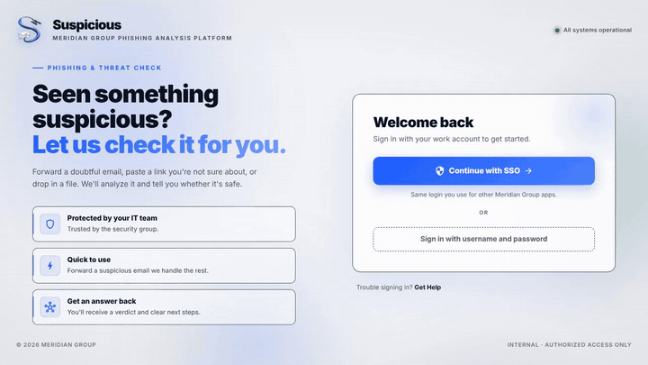
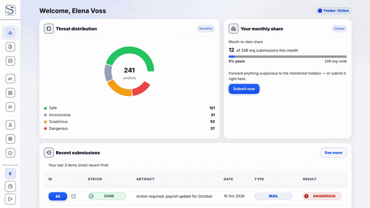
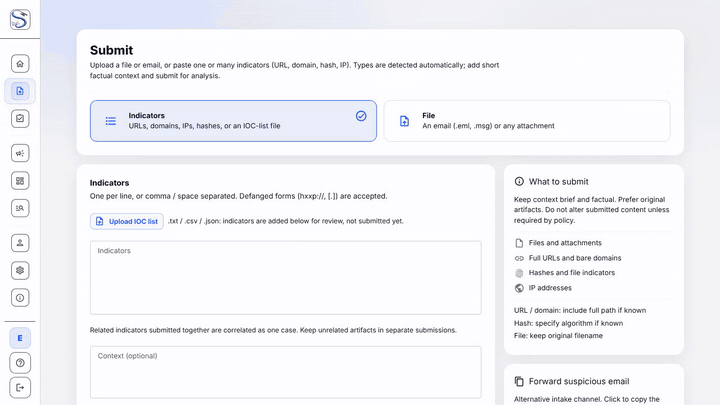
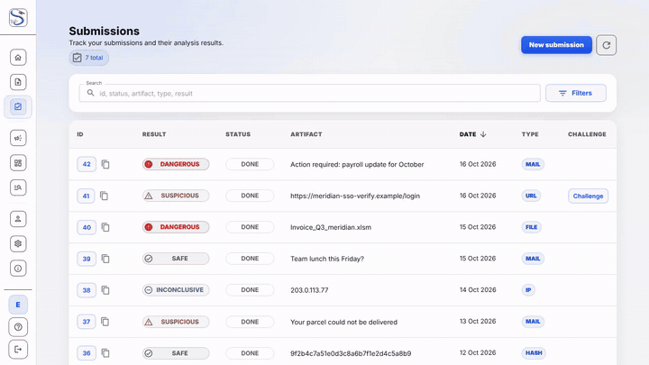
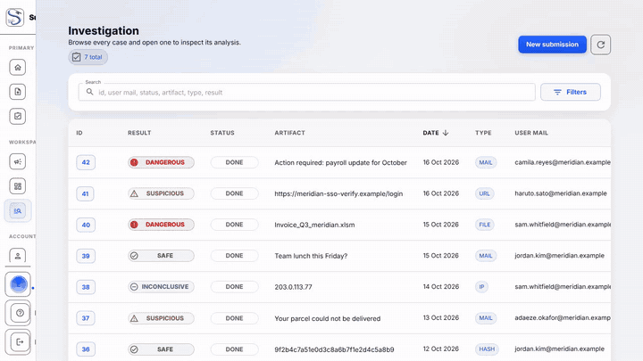
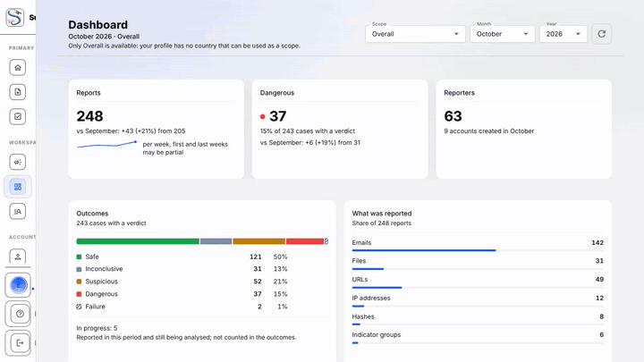
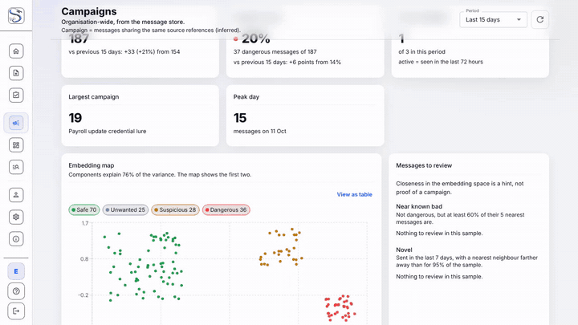
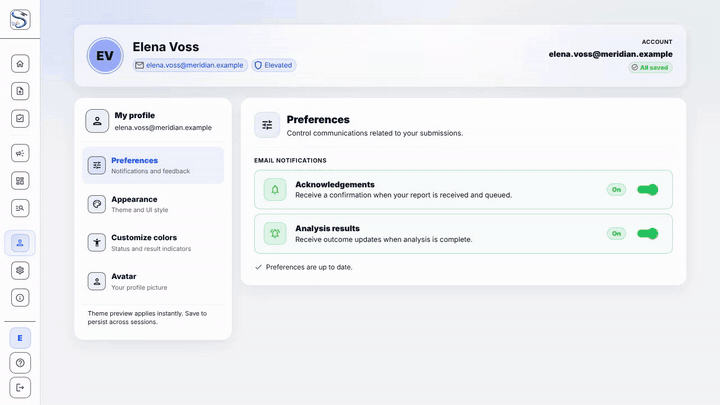
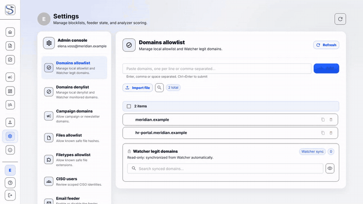

<p align="center">
    <picture>
        <source media="(prefers-color-scheme: dark)" srcset="/assets/suspicious-logo.png">
        
    </picture>
</p>
<p align="center">
    <strong>Phishing & threat-analysis platform</strong>
</p>

<p align="center">
    <a href="https://github.com/thalesgroup-cert/suspicious/actions/workflows/ci.yml">
        
    </a>
    <a href="https://github.com/thalesgroup-cert/suspicious/graphs/contributors">
        
    </a>
    <a href="https://github.com/thalesgroup-cert/suspicious">
        
    </a>
    <a href="https://github.com/thalesgroup-cert/suspicious/issues?q=is%3Aissue+is%3Aclosed">
        
    </a>
    <a href="./LICENSE">
        
    </a>
</p>

# Suspicious

> **Documentation:** <https://thalesgroup-cert.github.io/suspicious/>

Suspicious inspects, classifies, and reports suspicious emails, files, URLs, IPs,
and file hashes. Submit an item from the web UI or forward an email to a
monitored mailbox; Suspicious runs it through YARA rules, a sandbox, metadata
checks, and a machine-learning email classifier (the `ai_inference` server), then returns a scored verdict
and a full report.

Built and maintained by the [Thales Group CERT](https://www.thalesgroup.com/).

## Demo

<p align="center">
    <a href="https://thalesgroup-cert.github.io/suspicious/demo/">
        
    </a>
</p>

**[Watch the full walkthrough with subtitles](https://thalesgroup-cert.github.io/suspicious/demo/)**
(about 100 seconds), or open the [MP4](docs/assets/demo/suspicious-demo.mp4) directly.
The video is generated by a Playwright script, so it stays in step with the UI:
see [Product demo](https://thalesgroup-cert.github.io/suspicious/demo/#how-the-video-is-made).
Page-by-page clips are in the [Product tour](#product-tour) below.

## What it does

- **Analyzes** emails (`.eml`, `.msg`), documents, archives, executables, URLs,
  IP addresses, and file hashes.
- **Scores** each submission as Safe, Inconclusive, Suspicious, or Dangerous.
- **Reports** results through a web UI with dashboards, per-analyzer output, and
  submission history.
- **Ingests** email automatically from IMAP/IMAPS mailboxes.
- **Notifies** reporters of the outcome by email.
- **Integrates** with Cortex, TheHive, MISP, LDAP, Elasticsearch, ChromaDB, and
  S3-compatible or Google Cloud storage.

## Quick start

Requires Docker and Docker Compose v2.

```bash
git clone https://github.com/thalesgroup-cert/suspicious.git
cd suspicious

# Example configs that run as-is for local development
cp docs/getting-started/examples/deployment-env.example          deployment/.env
cp docs/getting-started/examples/Suspicious-settings.example.json Suspicious/settings.json

cd deployment
bash scripts/gen-service-secrets.sh .env .env.data   # fills the data-service passwords
docker network create suspicious_net
docker compose build suspicious
docker compose up -d db_suspicious redis_cache redis_broker chromadb chromadb_proxy
docker compose up -d --no-deps suspicious
make migrate
make seed-config
make createsuperuser
```

Open <http://localhost:9020/admin/> and sign in.

> The example configs use throwaway local credentials. Change every secret
> before exposing the app. Full guide, the complete stack (UI, HTTPS, Cortex),
> and configuration reference: **[INSTALL.md](INSTALL.md)** and **[CONFIG.md](CONFIG.md)**.

## Configuration

Three files hold all configuration. Templates ship in the repo.

| File | Purpose |
|------|---------|
| `deployment/.env` | Image versions, ports, paths, database and storage credentials |
| `Suspicious/settings.json` | Django settings, integrations, branding, SMTP, allowed domains |
| `email-feeder/config.json` | IMAP/IMAPS mailboxes, S3 storage, polling interval |

See **[CONFIG.md](CONFIG.md)** for every parameter.

## Architecture

| Component | Role |
|-----------|------|
| **Django REST API** | Submission, analysis orchestration, reports. Gunicorn on port 9020. |
| **React UI** (React 19, Vite, MUI 9) | Frontend served by Nginx on port 9021. |
| **Celery worker** (`suspicious_celery`) | Background jobs: Cortex reconciliation, connector deliveries, AI provider calls, retraining. |
| **Celery beat** (`suspicious_celery_beat`) | Separate scheduler container. Without it no periodic task runs (email polling, stale-job rescue, connector sync, KPI snapshots). |
| **MariaDB 11.4** | Metadata, results, KPIs. Holds the `CaseAnalyzerJob` ledger behind the Cortex webhook lookup. |
| **Valkey 9** | Celery broker and Django cache (per-case lock, webhook dedup). |
| **Elasticsearch** | Search and indexing. |
| **Cortex** | Analyzer engine: YARA, sandbox, metadata, FileInfo. Reports back via an HMAC-signed webhook. No AI analyzer. |
| **`ai_inference`** | AIMailAnalyzer model server (FastAPI, compose profile `ai`, internal port 8090). Holds the encoder and classifier weights; also runs retraining jobs. |
| **`ai_model` connector** | Calls `ai_inference` for the mail AI verdict, runs campaign detection and the review-mailbox label sync. Off by default. |
| **ChromaDB** | Vector store for campaign detection (collection `suspicious_mails`), behind a token-checking proxy. |
| **`mail_renderer`** | Isolated headless Chromium that draws the mail preview image; no route out. |
| **Object storage** | RustFS (S3 API) by default, or Google Cloud Storage (`storage.provider`). Uploads, attachments, previews, AI datasets and model bundles. |
| **Email Feeder** | Polls IMAP/IMAPS mailboxes and imports emails. Runs as a non-root user. |
| **Traefik** | Reverse proxy and TLS termination. |
| **Vault** | Production secret storage. |

Network layout, the service table and diagrams are in
[Architecture](docs/architecture.md).

### How an analysis runs

1. Django creates a `Case`. For each Cortex analyzer it writes an
   `AnalyzerReport` and a `CaseAnalyzerJob` row in one transaction, pinning the
   `(case, cortex job)` mapping at dispatch. A mail with a readable archive is
   also handed to the `ai_model` provider (a `provider-` ledger row), if enabled.
2. Cortex runs each analyzer and posts to the HMAC-signed webhook on completion.
3. The webhook looks up the case in `CaseAnalyzerJob` and enqueues
   `reconcile_case`. The task takes a per-case Redis lock and calls
   `reconcile_case_core`, which syncs the ledger and advances the case state.
4. When no job is pending, `reconcile_case_core` aggregates the score and the
   case reaches its final verdict, then emits `case_finalised`.
5. Every connector subscribed to `case_finalised` fires independently: MISP,
   SMTP notification to the reporter, `ai_narration`, the ChromaDB cleanup, and
   the `ai_model` campaign detection. TheHive alerts come from the challenge
   flow, the push button and campaign detection.
6. Celery beat re-checks any webhook the platform missed (every 300 s) and fails
   jobs stuck past `STALE_JOB_TIMEOUT_SECONDS` (every 600 s), so cases never stall.

## AI email classifier

`Analyzers/AIMailAnalyzer` classifies emails by intent (phishing, malicious,
suspicious, benign) with a Sentence-Transformers embedding model and a custom
classifier. It runs as the `ai_inference` model server, not as a Cortex
analyzer. The `ai_model` connector sends it the mail text and stores the
answer; the same connector runs campaign detection against ChromaDB and the
retraining pipeline (label ledger, gate, shadow, promotion, rollback).

The connector is **off by default**. To enable it, set `AI_INFERENCE_TOKEN` in
`deployment/.env` (an empty token makes the `/v2` API answer 503), put the same
value in the connector's `token`, start the `ai` compose profile and enable
`ai_model` in Settings. Without it a mail gets no AI vote and is usually
finalised as Inconclusive. Step-by-step setup, retraining and troubleshooting:
**[AI inference guide](docs/getting-started/ai-inference.md)**; reference in
[AI / ML Analyzers](docs/components/analyzers.md).

Use the classifier alongside YARA, sandbox, and metadata analyzers. Do not
auto-block on it alone.

## Contributing

See **[CONTRIBUTING.md](CONTRIBUTING.md)** for coding standards and the pull
request flow.

```bash
git checkout -b feature/your-feature
# make changes, commit, push
# open a pull request
```

Bug reports and ideas are welcome in [issues](https://github.com/thalesgroup-cert/suspicious/issues).

## Product tour

Short clips of each page, recorded from the real UI with fictional data.
The same clips, with more context, are in the
[UI tour](https://thalesgroup-cert.github.io/suspicious/user-guide/tour/).

### Login



### Home



### Submit



### My submissions



### Investigation



### Dashboard



### Campaigns



### Profile



### Settings



## CI/CD

GitHub Actions runs six workflows plus Dependabot under `.github/`.

| Workflow | Trigger | Runs |
|----------|---------|------|
| `ci.yml` | PRs and pushes to `main`/`test` | commit-lint, `ruff`, migration-drift check, Django tests, feeder tests, frontend (eslint + tsc + vitest + build), image builds |
| `e2e-deploy.yml` | PRs, pushes to `main`/`feature/frontweb` | full-stack deploy smoke test against a stubbed Cortex |
| `docs.yml` | PRs and pushes to `main` | builds the MkDocs site and deploys it to GitHub Pages |
| `release.yml` | pushes to `main`/`test`, `v*` tags | builds and pushes images to GHCR with SBOM and provenance |
| `codeql.yml` | PRs, pushes to `main`, weekly | CodeQL for Python and JS/TS |
| `security.yml` | PRs, weekly | Trivy, gitleaks, `pip-audit`, `pnpm audit` |

### Published images (GHCR)

| Component | Image |
|-----------|-------|
| Django API | `ghcr.io/thalesgroup-cert/suspicious` |
| Frontend | `ghcr.io/thalesgroup-cert/suspicious-ui` |
| Email feeder | `ghcr.io/thalesgroup-cert/suspicious-feeder` |

Deployment is manual via `deployment/Makefile` (`make deploy`); CI never holds
production credentials.

## License

Released under the **Apache License, Version 2.0**. See [`LICENSE`](LICENSE).

## Contact

Questions, ideas, or bugs: open an
[issue](https://github.com/thalesgroup-cert/suspicious/issues).
