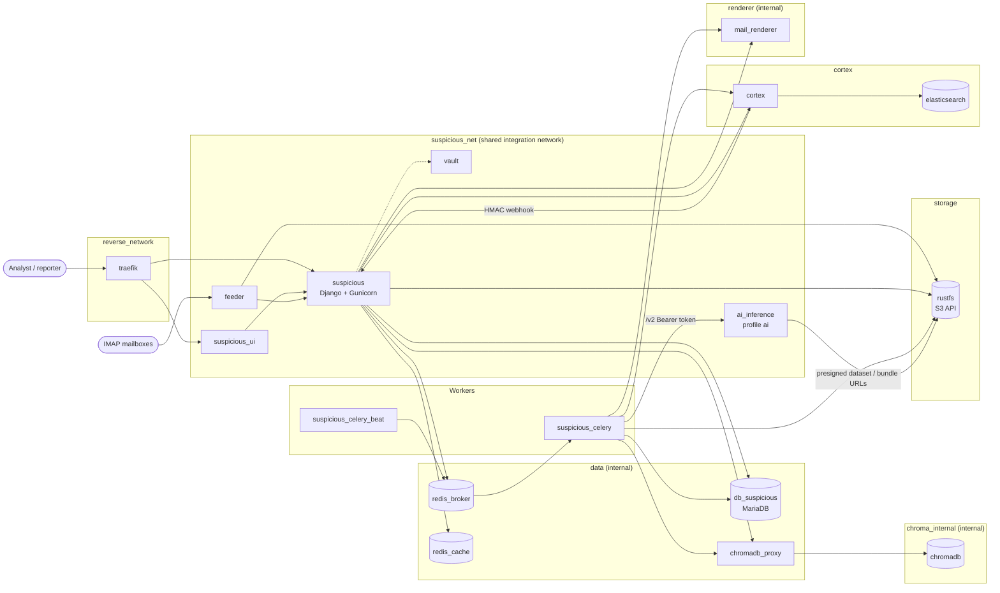
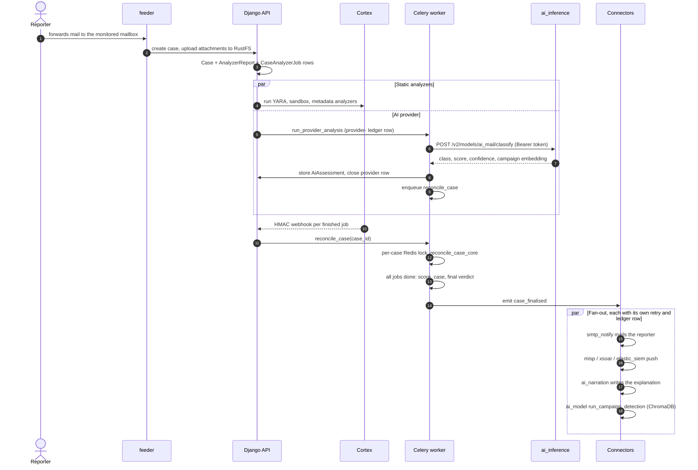
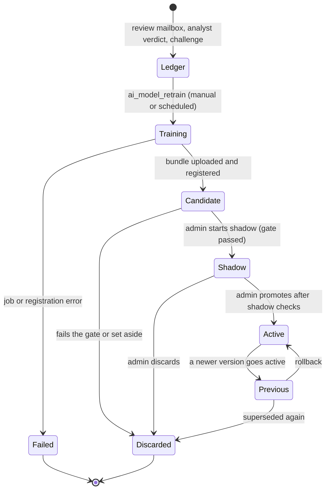

# Architecture

Suspicious is a set of containerised services coordinated by a Django REST API
and Celery. Cortex runs the static analyzers (YARA, sandbox, metadata,
FileInfo); the AI email verdict comes from the `ai_inference` model server,
called by the `ai_model` connector. Compose files live in `deployment/`
(`docker-compose.yml` for the whole stack, `compose_databases.yaml`,
`compose_apps.yaml` and `compose_reverse_proxy.yaml` for the split layout).

## System overview

`suspicious_net` is the compose key `suspicious_network`, an external network
named by `NETWORK_NAME` (`suspicious_net` in `.env.example`) and created with
`make network`. The other networks segment the stack:

| Network | Internal | Members |
|---|---|---|
| `suspicious_net` | no | Reverse proxy, UI, Django, Celery, beat, feeder, `ai_inference`, Vault, and peers such as TheHive or MISP |
| `data` | yes | MariaDB (and replica), both Valkey instances, `chromadb_proxy`; reachable only by Django, Celery and beat |
| `chroma_internal` | yes | `chromadb` and its proxy |
| `storage` | no | RustFS; Django, Celery, feeder and `ai_inference` |
| `cortex` | no | Cortex and Elasticsearch; Django and Celery |
| `renderer` | yes | `mail_renderer`; Django and Celery, no route out |
| `reverse_network` | no | Traefik and the UI |

## Services

| Service | Role |
|---|---|
| `suspicious` | Django REST API (Gunicorn, port 9020) |
| `suspicious_celery` | Celery worker: Cortex sync, reconciliation, connector deliveries, provider analysis, retraining jobs |
| `suspicious_celery_beat` | Celery beat scheduler, a separate container from the worker. Without it no periodic task fires (see below) |
| `suspicious_ui` | React/Vite frontend (Nginx, port 9021) |
| `db_suspicious` | MariaDB 11.4 (primary; opt-in replica `db_suspicious_replica` via the R6 router) |
| `redis_broker` / `redis_cache` | Valkey 9: Celery broker and Django cache (per-case lock, webhook jobId dedup). Passwords required (`REDIS_*_PASSWORD`) |
| `elasticsearch` | Search, indexing and Cortex's job store (8.19); security enabled, per-service accounts (`ES_SUSPICIOUS_*`, `ES_CORTEX_*`) |
| `rustfs` | S3-compatible object storage for artifacts, attachments, mail previews, AI datasets and model bundles |
| `cortex` | Analyzer execution engine (YARA, sandbox, metadata, FileInfo, URL and domain analyzers). It no longer runs an AI analyzer. Reports back by HMAC-signed webhook, spawning analyzer containers through `docker_proxy_cortex` |
| `ai_inference` | AIMailAnalyzer model server (FastAPI, compose profile `ai`, port 8090, no host port). Holds the sentence-transformer encoder and classifier weights. `/v2` API guarded by `AI_INFERENCE_TOKEN` |
| `chromadb` / `chromadb_proxy` | Vector DB for campaign detection (collection `suspicious_mails`); reachable only through the token-checking nginx proxy (`CHROMA_TOKEN`) |
| `feeder` | IMAP poller that auto-ingests emails (container `email_feeder`, non-root) |
| `mail_renderer` | Headless Chromium that draws the mail preview PNG from sanitised HTML |
| `vault` | Secrets store for connector credentials and runtime secrets |
| `traefik` | Reverse proxy with TLS termination |
| `tempo` / `grafana` | Optional OpenTelemetry trace store and dashboards, started manually from `deployment/docker/monitoring/` |

Default image versions are in `deployment/.env.example`: MariaDB 11.4,
Valkey 9, Elasticsearch 8.19, ChromaDB 1.5, Cortex 4.1, Traefik 3.6, RustFS
1.0.0-alpha. `ai_inference` is built locally
(`aimailanalyzer-inference:${AI_INFERENCE_VERSION:-local}`).

### Celery worker and beat

The worker executes tasks; the beat container only schedules them. Schedule
entries are in `suspicious/settings.py` (`CELERY_BEAT_SCHEDULE`) and include
`update_ongoing_cases` (300 s, webhook fallback), `fail_stale_jobs` (600 s),
`sync_user_profiles`, `sync_monthly_kpi`, `sweep_missing_mail_previews`,
`purge_old_mail_previews`, `materialise_dashboard_snapshots` and
`delete_old_reports`. Connectors register their own entries at startup
(`connectors/apps.py`), for example per-connector sync and the `ai_model`
retrain check and registry sync.

## Request and analysis flow

1. A user submits an email, file, URL, IP or hash through the web UI, the API,
   or the email feeder's IMAP polling.
2. Django creates a `Case`, then dispatches Cortex analyzers through
   `CortexJob.run_analyzer`. Each call writes an `AnalyzerReport` and a
   `CaseAnalyzerJob` ledger row atomically (`case_id` to `cortex_job_id`).
3. For a mail with a readable archive, Django also hands the case to the
   enabled `mail_ai` provider connector (`ai_model`): a pending
   `CaseAnalyzerJob` row with a `provider-` job id is written and a Celery task
   calls `ai_inference`. The answer is stored as an `AiAssessment` plus the
   case's AI fields, and the row is closed. With no provider enabled the mail
   gets no AI vote (`Inconclusive`, treated as missing by scoring).
4. Cortex runs the analyzers asynchronously and POSTs to
   `/api/cortex/webhook/` (HMAC-signed, jobId-deduped) as each job finishes.
5. The webhook view finds the case with one indexed read on
   `CaseAnalyzerJob` and enqueues `tasp.tasks.reconcile_case(case_id)`. The task
   takes a per-case Redis lock and calls `reconcile_case_core`
   (`cortex_job/cortex_utils/reconciliation.py`), the single entrypoint that
   syncs the ledger and advances the case's lifecycle state machine.
6. When all jobs are done, `reconcile_case_core` aggregates the final score
   (Safe, Inconclusive, Suspicious, Dangerous) and emits `case_finalised`
   through `connectors.dispatch.emit`.
7. Every connector subscribed to the event fires independently (see below) and
   dashboard KPIs are updated.
8. Celery beat runs `update_ongoing_cases` as a fallback for lost webhooks and
   `fail_stale_jobs` to fail any `CaseAnalyzerJob` row pending beyond
   `STALE_JOB_TIMEOUT_SECONDS` (2 h default).

## Connectors event flow

Connectors are the integration framework (`connectors/`): registry, dispatch,
delivery ledger and a circuit breaker per connector. A connector declares which
of four events it handles: `case_created`, `case_finalised`, `case_modified`,
`campaign_updated`. `emit` writes one delivery row per subscribed, enabled
connector and runs each hook as its own Celery task, so one failing connector
never blocks another. A connector can also declare that it provides an analysis
(`provides = "mail_ai"`, one enabled per kind); `ai_model` is the only one.

Built-in connectors: TheHive, MISP, Watcher, SMTP notify, ChromaDB (collection
cleanup), `ai_narration`, `case_search`, `elastic_siem`, `xsoar`, `ai_model`.
Connectors are enabled in Settings; `ai_model` is off by default. See
[Connectors](components/backend/connectors.md) and the
[author guide](connectors.md). TheHive alerts come from the challenge flow, the
push button and campaign detection, not from `case_finalised`.

## AI path: ai_model connector and ai_inference

The `ai_model` connector is off by default. To use it, set the same
`AI_INFERENCE_TOKEN` in `deployment/.env` (read by `ai_inference`) and in the
connector's `token`, set its `url` (`http://ai_inference:8090`), start the
`ai` profile and enable the connector. Setup: [AI inference
guide](getting-started/ai-inference.md); reference:
[AI / ML Analyzers](components/analyzers.md).

- **Classification.** The connector posts the mail text to
  `/v2/models/ai_mail/classify`; while a shadow model exists it asks for both
  `active` and `shadow` in the same call.
- **Campaign detection.** On `case_finalised` the connector embeds the case
  into ChromaDB (`suspicious_mails`) and groups similar mails into campaigns,
  emitting `campaign_updated`.
- **Label ledger.** A review mailbox (IMAP), analyst verdicts and reporter
  challenges feed a ledger of labelled mails (`ai_model.models.LabelRecord`).
- **Retraining.** `ai_model_retrain` (beat check, management command or the
  Settings card) trains a candidate in `ai_inference` from a dataset handed
  over as a presigned RustFS URL; the finished bundle goes back to RustFS.

Statuses are those of `ModelVersion.Status`. Nothing starts a shadow or
promotes a version without an admin. The server hot-reloads on `/v2/reload`;
version 0 is the legacy weights bind-mounted from
`Analyzers/AIMailAnalyzer/models/`.

## Storage

Object storage goes through `common/storage`, selected by `storage.provider`
in `settings.json` or the `STORAGE_PROVIDER` variable (default `s3`). The
registered providers are `s3` (RustFS or any S3 API) and `gcs` (Google Cloud
Storage; see [CONFIG.md](https://github.com/thalesgroup-cert/suspicious/blob/main/CONFIG.md)
for its keys and limits). Relational data is in MariaDB, vectors in ChromaDB,
search in Elasticsearch, and the cache, per-case lock and webhook dedup in
Valkey.

## URL analysis planning

URLs extracted from a reported email are not all dispatched blindly. At
dispatch time (step 2, mail path only), `plan_url_analysis` collapses
equivalent URLs by canonical key, reuses recent results across cases within
`reuse_ttl_days`, and caps analysis per registered domain to the most
interesting URLs. Every extracted URL is still recorded; capped ones are
marked `skipped` and stay analyzable on demand via
`POST /api/submissions/<id>/urls/<url_id>/analyze/`. The planner is fail-open
(any error means the URL is analyzed) and kill-switched by
`url_analysis.enabled`. Direct single-URL submission bypasses it. See
[Observable Processors](components/backend/observable-processors.md#url-analysis-planner-url_process).

## Observability

OpenTelemetry tracing is optional and disabled by default. Set
`observability.opentelemetry.enabled` in `settings.json` and start the Tempo and
Grafana stack from `deployment/docker/monitoring/` (Grafana on port 3000). See
[Monitoring](operations/monitoring.md). Container health is visible with
`make status`; `GET /api/health/` reports database, Redis and Cortex.

See [Components](components/backend/index.md) for each part in detail, and the
[API Reference](reference/rest-api.md) for endpoints.
