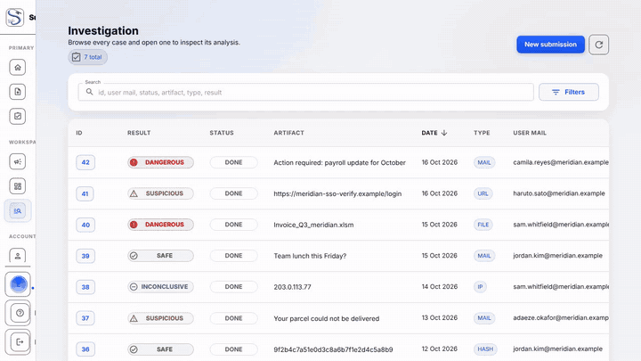

# Investigations

Browse, filter, and read the verdict and reports for a case.

## Why this verdict

Every scored case shows a plain-language explanation of its verdict, not just
the Safe/Suspicious/Dangerous/Inconclusive band. It's a short analyst-facing
paragraph plus a confidence reading, generated deterministically from the
same scoring inputs that set the band — never a separate, independently
"guessed" verdict. Click **Show source breakdown** to see which sources
counted toward the decision and why.

## AI model assessment

When an administrator has enabled the `ai_model` connector, the case view (the
investigation overview and the submission drawer) shows an **AI model
assessment** section for mail cases the model has analysed. Nothing is shown
while the connector is off or when the mail could not be analysed.

- **Result:** the model's class (Safe, Unwanted, Dangerous or Inconclusive), a
  sub-class chip when there is one, and a confidence tier: **High** ("the model is
  confident"), **Medium** ("the model leans this way, check the evidence") or
  **Low** ("the model is unsure, rely on the other evidence"). On Low the
  runner-up class is shown. No numeric confidence is displayed. "Confidence not
  calibrated" appears when the active model has no tiers (the legacy version).
- **Model line:** the model version, when the case was analysed, and what the
  model read: the body text only, not the headers or attachments.
- **Campaign:** the campaign reference and its number of mails when the case
  belongs to a detected campaign.
- **Similar cases:** a table of earlier cases the model found alike, with their
  label and provenance. You only see the cases you are allowed to open.

Investigators and administrators (users who can see the case beyond their own
submission) also get the analyst material: a **cross-check** list of the facts
behind the verdict (decisive rule, counted sources, a deny or allow list hit), a
warning **AI disagrees with the evidence** when the model sits on the opposite
side of Safe/Dangerous from the case verdict, the labels analysts gave the other
campaign mails, and a warning **Campaign members disagree** when those labels
conflict. The assessment is context for the analyst: the verdict itself still
comes from the scoring described in *Why this verdict*.

## Downloading the full report

The **Full report** button (on a case's detail view) downloads a
self-contained HTML file with one block per indicator: verdict, why, key
findings, type-specific details (location, Whois, categorization, URL, hash,
VirusTotal), the connectors that ran with a legend, and any captured
screenshots (collapsed, inlined so the file works offline with no login).
Mail and file cases show their embedded indicators and analyzers, and mail
cases the AI model assessment. Raw analyzer output is not embedded.
It's available to anyone who can see the case — the case's own reporter as
well as investigators — and it follows your OS/browser's light or dark
preference automatically. The AI model section is built for the user who
downloads it: a reporter sees no cross-check and no campaign labels. A URL
indicator never gets a domain-age finding, because VirusTotal's URL records
carry no creation date.

## Verdict narration (optional, admin-configured)

If an administrator has enabled the `ai_narration` connector, a finalised
case also gets an LLM-generated narrative summary, generated from the same
locked-in verdict facts so it can never contradict the actual score. This is
currently an operational/audit feature (visible in logs, not yet rendered in
the UI or the downloadable report) — ask your administrator if you're not
sure whether it's active for your deployment.
