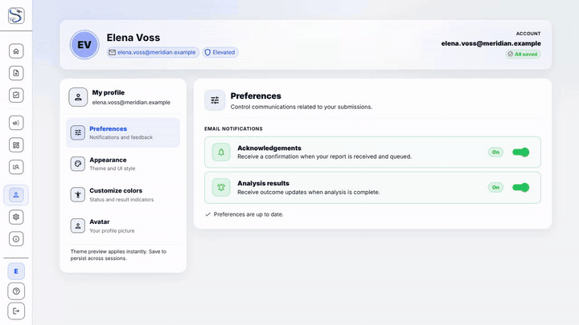
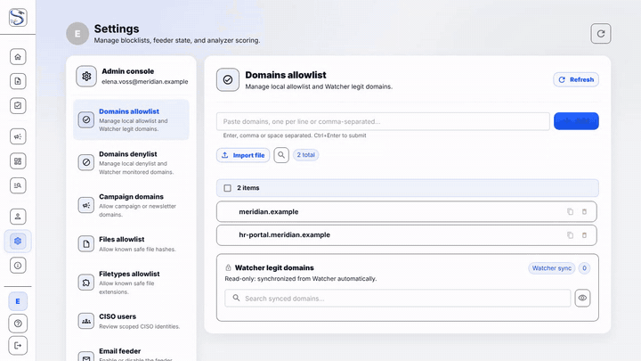

# Profile & Settings

Manage your profile, appearance, and platform settings.

Admins and CERT also get the **Settings** console: allow and deny lists, the email feeder switch and analyzer scoring weights.

## AI model card

The **AI model** card sits in the Settings console under **Integrations**. It
appears only for users in the `Admin` group and only while the `ai_model`
connector is enabled (the connector's tile in **Connectors** links to it). It
manages the mail classifier's versions through five tabs. The API behind it lets
the CISO group read the same data; every change needs Admin.

| Tab | What it shows and does |
|---|---|
| Overview | Connector health, the circuit breaker (with **Reset breaker** when it is open or half-open), the active version (with a warning when it is older than 60 days and "Confidence not calibrated" for the legacy version), labels by class and source, the automatic-retrain schedule, and **Start a retrain** |
| Candidate | The model a retrain produced: rows used and excluded, the quality gate results, **Start shadow** (only when the candidate passed the gate and no shadow is running) and **Discard** |
| Shadow | The shadow model's progress (results against the 500 needed), the verdict changes and campaign differences you must review, the promotion conditions, and **Promote**, **Extend** (new total days), **Recheck** and **Discard** |
| Versions | The version history with scored and Dangerous counts, campaigns created and joined, alerts, label purity and warnings, and **Rollback** to the previous version |
| Ledger | Labels by source, the label mix now against the training set, flagged labels to **Keep** or **Drop** (with a note), and the review queue of cases where the AI disagrees with the evidence and of campaigns whose members disagree |

What the actions do:

- **Retrain** trains a new model from the label ledger on the inference server and
  stores it as a *candidate*. It never changes what runs. One job at a time; a
  failed scheduled run backs off for 7 days.
- **Shadow** runs the candidate next to the live model on new mails (and replayed
  past cases) and records what it would have decided, without affecting any verdict.
- **Promote** makes the shadow the live model. It is refused until the shadow
  window has passed, enough results exist, each critical verdict change (Safe to
  Dangerous or the reverse) and campaign difference has a recorded review, the gate
  recheck is fresh and no job is running. The refusal names the unmet conditions.
- **Rollback** returns to the previous version; **Discard** drops a candidate or
  shadow.

Every action asks for confirmation and is written to the model's audit trail.
Operations and troubleshooting: [AI / ML Analyzers](../components/analyzers.md).
