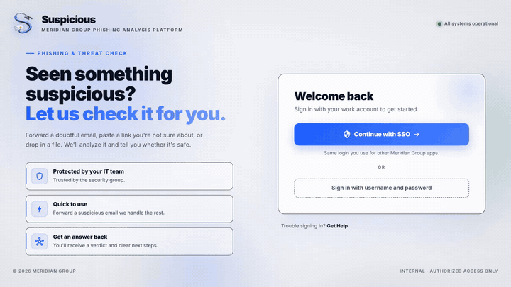
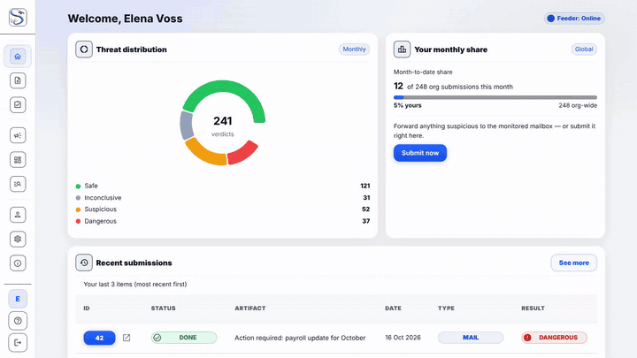
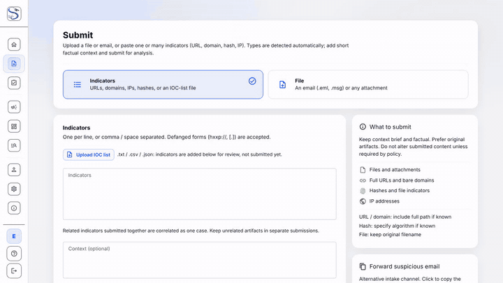
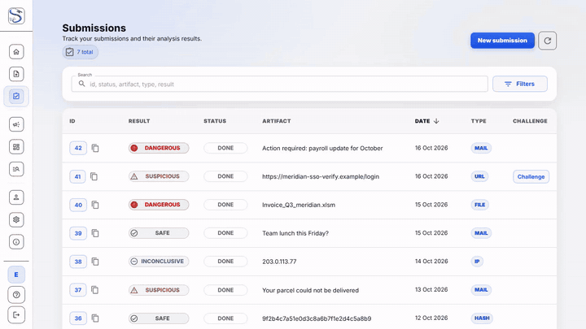
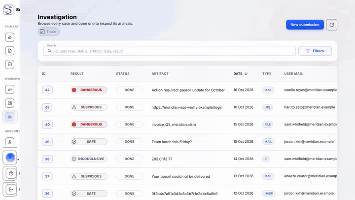
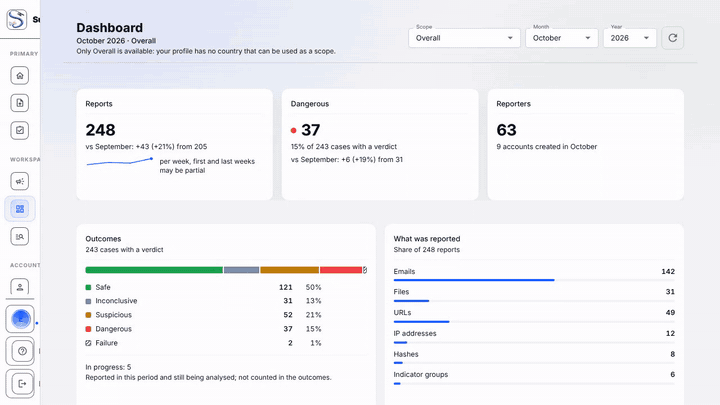
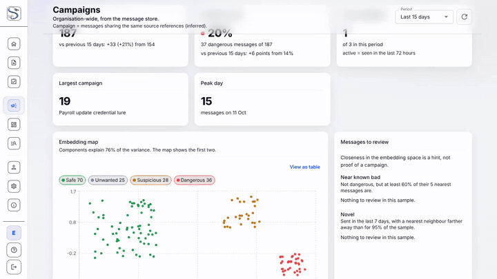
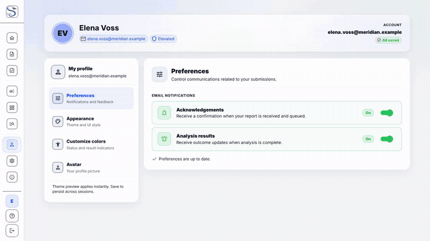
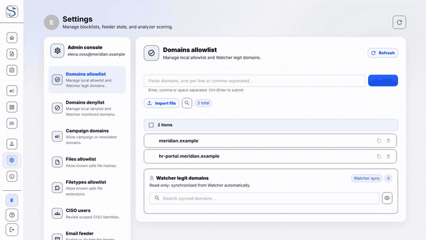

# UI tour

A short animated look at each page of the web UI. The clips are recorded
from the real app with fictional data ("Meridian Group"). For a narrated,
subtitled walkthrough, see the [product demo](../demo.md).

## Sign in

Sign in with SSO, or expand the local-account form.



## Home

The month's verdicts across the organisation, your share of reports, and your latest submissions.



## Submit

Paste URLs, domains, IPs and hashes, or upload a file. Types are detected
automatically. See [Submitting](submitting.md).



## My submissions

Search your reports and open any case to see its verdict and analysis.



## Investigation

The CERT workspace: every case, the explained verdict and the per-source breakdown.
See [Investigations](investigations.md).



## Dashboard

Volumes, outcomes and top reporters, month over month. See [Dashboard](dashboard.md).



## Campaigns

Similar messages clustered with ML embeddings, so a coordinated wave stands out.
See [Campaigns](campaigns.md).



## Profile and Settings

Personal preferences and appearance for everyone; allow/deny lists, the email
feeder and analyzer scoring for Admin and CERT. See [Profile & Settings](profile.md).





## Regenerating these clips

```bash
cd suspicious-ui
pnpm demo:gifs   # record every page (demo/pages.demo.ts), then encode to docs/assets/gifs/
```

Needs `ffmpeg` and Playwright's Chromium (`pnpm exec playwright install chromium`).
